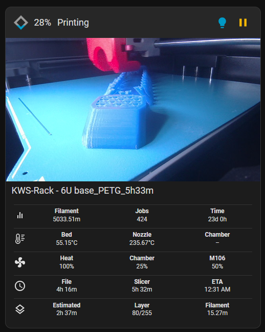

# Printer Card

A Home Assistant dashboard card for your 3D printer: a live camera image, print progress, temperatures, fans, times and quick controls, all in one card.



## Features

- **Live camera** that keeps refreshing, even when the printer's own stream stalls. Click the image to open it full screen.
- **Progress in the header**: a diamond that fills up, the percentage and the printer status in its own color.
- **Controls in the header**: chamber light, pause, resume and cancel. Pause only shows while printing; resume and cancel only show while paused.
- **Up to five rows of data**: totals, temperatures, fans, times and layer progress. Turn off any row you don't need.
- **Follows your Home Assistant theme** (light and dark), with optional colors of your own.
- **Translated** into English, Dutch, German, Czech and Greek. The card picks the language of your Home Assistant profile.

## Installation

### HACS (recommended)

[HACS](https://hacs.xyz) must already be installed in Home Assistant.

**1. Add this repository to HACS**

1. Open **HACS** from the Home Assistant sidebar.
2. Click the **three dots** in the top right and choose **Custom repositories**.
3. Fill in:
   - **Repository**: `https://github.com/jrhessels/printer-card`
   - **Type**: **Dashboard**
4. Click **Add**, then close the window.

**2. Download the card**

1. Search for **Printer Card** in HACS.
2. Open it and click **Download** in the bottom right.
3. Confirm with **Download** again.
4. Refresh your browser with **Ctrl+F5** (on a Mac: **Cmd+Shift+R**).

HACS adds the resource to your dashboard for you, as a JavaScript module. You don't have to add it yourself.

**3. Check that it works**

Press **F12** and open the **Console** tab. You should see `PRINTER-CARD v1.0.0` (or a newer version). Then add the card to your dashboard, see [Configuration](#configuration).

**Updates**

HACS checks this repository for new releases. When there is one, you'll get a notification under **Settings → Updates**, just like for your other HACS components. Click **Update**, then refresh your browser with Ctrl+F5.

### Switching from a manual installation to HACS

Did you install the card by hand before? Do it in this order, so the card isn't loaded twice:

1. Go to **Settings → Dashboards → three dots → Resources** and delete the old resource (`/local/printer-card/...`).
2. Install the card through HACS as described above.
3. Delete the `printer-card` folder from `config/www/`.
4. Refresh your browser with Ctrl+F5.

Your dashboard configuration stays the same: `type: custom:printer-card` keeps working.

### Manual

1. Copy the contents of the `dist` folder to `config/www/printer-card/`, so you end up with:
   ```
   config/www/printer-card/
   ├── printer-card.js
   └── translations/
       ├── en.js
       ├── nl.js
       └── ...
   ```
2. Go to **Settings → Dashboards → three dots → Resources → Add resource**.
3. URL: `/local/printer-card/printer-card.js`
   Type: **JavaScript module**
4. Refresh your browser (Ctrl+F5).

> The type must be **JavaScript module**. With plain "JavaScript" the card can't load its translations and won't start.

## Configuration

Add a card to your dashboard, choose **Manual** and paste the configuration below. Replace the entity IDs with your own. You can find them under **Developer tools → States**.

Only `entities.camera` is required. Everything else is optional: a value you leave out shows a dash (–).

```yaml
type: custom:printer-card
entities:
  camera: camera.my_printer_camera

  printer:
    status: sensor.my_printer_print_state
    timeleft: sensor.my_printer_time_left
    eta: sensor.my_printer_eta
    jobstotal: sensor.my_printer_total_jobs
    timetotal: sensor.my_printer_total_print_time

  file:
    name: sensor.my_printer_filename
    progress: sensor.my_printer_progress
    duration: sensor.my_printer_print_duration

  slicer:
    duration: sensor.my_printer_slicer_estimate

  temperature:
    bed: sensor.my_printer_bed_temperature
    nozzle: sensor.my_printer_nozzle_temperature
    chamber: sensor.my_printer_chamber_temperature

  fan:
    driver: sensor.my_printer_heat_fan
    chamber: sensor.my_printer_chamber_fan
    m106: sensor.my_printer_part_fan

  layer:
    current: sensor.my_printer_current_layer
    total: sensor.my_printer_total_layers

  filament:
    used: sensor.my_printer_filament_used
    total: sensor.my_printer_total_filament_used

actions:
  led: light.my_printer_chamber_light
  pause: button.my_printer_pause
  resume: button.my_printer_resume
  cancel: button.my_printer_cancel
```

### Entities

| Group | Key | What it shows | Expected value |
|---|---|---|---|
| | `camera` | Camera image (**required**) | `camera.*` entity |
| `printer` | `status` | Status in the header, and which buttons are shown | Text, e.g. `printing`, `paused` |
| | `timeleft` | Estimated time remaining | Duration |
| | `eta` | Clock time the print is done | Timestamp |
| | `jobstotal` | Total number of prints | Number |
| | `timetotal` | Total print time | Duration |
| `file` | `name` | File name under the camera | Text |
| | `progress` | Percentage and diamond in the header | Number, 0–100 |
| | `duration` | Duration of the current print | Duration |
| `slicer` | `duration` | Print time estimated by the slicer | Duration |
| `temperature` | `bed` | Bed temperature | Number |
| | `nozzle` | Nozzle temperature | Number |
| | `chamber` | Chamber temperature | Number |
| `fan` | `driver` | Heat break / driver fan | Number, % |
| | `chamber` | Chamber fan | Number, % |
| | `m106` | Part cooling fan | Number, % |
| `layer` | `current` | Current layer | Number |
| | `total` | Total number of layers | Number |
| `filament` | `used` | Filament used for this print | Number (unit is read from the entity) |
| | `total` | Total filament used | Number (unit is read from the entity) |

**Durations** can be in any of these forms:
- a number with a unit: `318` with unit `min`, `5.3` with unit `h` (`s`, `min`, `h` and `d` are supported)
- text: `5h 18m`, `548h 14m 22s`, `2d 3h`
- a clock notation: `5:18:00` or `18:00`

### Actions

| Key | Button | Shown when |
|---|---|---|
| `led` | Light (lights up when the entity is `on`) | Always |
| `pause` | Pause | Status is `printing` |
| `resume` | Resume | Status is `paused` |
| `cancel` | Cancel | Status is `paused` |

The card calls the right service based on the domain of the entity:
- `button.*` → `button.press`
- `script.*` → `script.turn_on`
- anything else (`light.*`, `switch.*`, ...) → `toggle`

A button without an entity in `actions` does nothing when clicked.

## Style

All style options are optional. Without them the card uses the colors of your Home Assistant theme.

```yaml
style:
  card:
    background: '#1c1c1c'
    color: '#ffffff'
    border_color: '#333333'
    accent_color: '#03a9f4'
  title:
    color: '#ffffff'
    font_size: 18px
    font_weight: 500
  states:
    totals: true
    temperature: true
    fan: false
    time: true
    progress: true
```

### `card`

| Key | What it changes | Default |
|---|---|---|
| `background` | Card background | Theme card background |
| `color` | Text color | Theme text color |
| `border_color` | Card border | Theme divider color |
| `accent_color` | Diamond, button hover and light when on | Theme primary color |

### `title`

Applies to the header and the file name.

| Key | What it changes | Default |
|---|---|---|
| `color` | Text color | Same as `card.color` |
| `font_size` | Text size | `18px` |
| `font_weight` | Text weight | Normal |

### `states`

Turn rows on or off. A row is only hidden when you set it to `false`; rows you don't mention stay visible.

| Key | Row |
|---|---|
| `totals` | Total filament, jobs and print time |
| `temperature` | Bed, nozzle and chamber |
| `fan` | Heat, chamber and part cooling fan |
| `time` | Print duration, slicer estimate and ETA |
| `progress` | Time remaining, layer and filament used |

## Language

The card uses the language of your Home Assistant profile. Supported languages:

| Code | Language |
|---|---|
| `en` | English |
| `nl` | Dutch |
| `de` | German |
| `cs` | Czech |
| `el` | Greek |

Any other language falls back to English. To force a language, add:

```yaml
language: de
```

## Printer status

The pause, resume and cancel buttons react to the values `printing` and `paused`. The header color follows the status:

| Status | Color |
|---|---|
| `printing` | Green |
| `paused` | Yellow |
| `idle` | Gray |
| `ready` | Orange |
| anything else | Red |

Not every integration uses the same words. If yours uses `running` or `pause`, for example, the buttons won't appear. Check the value of your status entity under **Developer tools → States**, and open an issue so support can be added.

## Troubleshooting

**"Custom element doesn't exist: printer-card"**
The card didn't load. Check that:
- the resource type is **JavaScript module**
- the `translations` folder sits next to `printer-card.js`
- you've refreshed with Ctrl+F5

Press F12 and look at the **Console** tab for the exact error.

**The card shows an old version after an update**
Your browser is using a cached copy. Refresh with Ctrl+F5. In the console (F12) you can see which version is loaded: `PRINTER-CARD v1.0.0`.

**The camera image stays black**
Check that `entities.camera` points to a `camera.*` entity and that the camera works in a regular Home Assistant picture card.

**A value shows a dash (–)**
The entity is missing from the configuration, doesn't exist, or is `unknown` or `unavailable`. Check the entity ID under **Developer tools → States**.

**A time looks wrong**
The card reads the raw state of the entity, not the value Home Assistant shows on screen. Check the state and the `unit_of_measurement` attribute under **Developer tools → States**.

## Adding a translation

1. Copy `dist/translations/en.js` to a new file named after the [language code](https://en.wikipedia.org/wiki/List_of_ISO_639-1_codes), e.g. `fr.js`.
2. Translate the text between the quotes. Leave the keys on the left as they are.
3. Add the language at the top of `dist/printer-card.js`:
   ```js
   import fr from './translations/fr.js?v=1.0.0';

   const TRANSLATIONS = { en, nl, de, cs, el, fr };
   ```
4. Open a pull request.

## License

MIT
